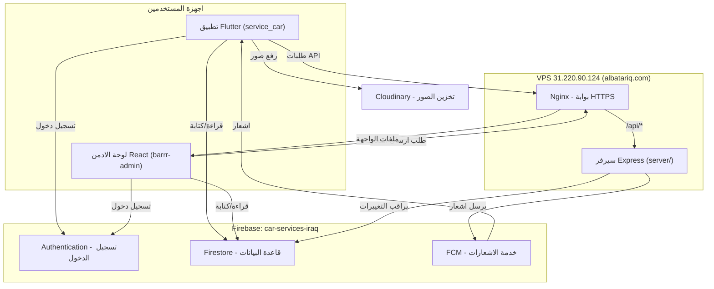
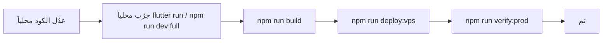

# كتيّب المشغّل — دليل البطريق الشامل

> هذا الملف هو **المرجع الأول** الذي ترجع إليه قبل سؤال أي مساعد ذكي.
> مكتوب بلغة مبسّطة من الأساس: يشرح *ما هو* كل شيء، ثم *ماذا تفعل* بالضبط في هذا المشروع.
> الملفات القديمة (`README.md` و`GUIDE.md` و`PRODUCTION.md`...) ما زالت صحيحة وهذا الكتيّب يجمعها ويشرح خلفيتها ويربطها.

إذا كنت مستعجلاً: اقفز مباشرة إلى [فهرس «أريد أن أفعل X»](#14-فهرس-أريد-أن-أفعل-x).

---

## الفهرس

1. [خريطة سريعة: ما هو المشروع وأين يعيش كل شيء](#1-خريطة-سريعة)
2. [المفاهيم بلغة بسيطة](#2-المفاهيم-بلغة-بسيطة)
3. [كيف تقرأ الكود](#3-كيف-تقرأ-الكود)
4. [التشغيل المحلي على جهازك](#4-التشغيل-المحلي)
5. [إعداد/تفعيل Firebase من الصفر](#5-تفعيل-firebase-من-الصفر)
6. [بناء Android ورفعه على المتجر](#6-بناء-android-ورفعه)
7. [بناء iOS ورفعه على المتجر](#7-بناء-ios-ورفعه)
8. [النشر على VPS](#8-النشر-على-vps)
9. [التحديث الآمن للإنتاج](#9-التحديث-الآمن-للإنتاج)
10. [حل المشاكل (Troubleshooting)](#10-حل-المشاكل)
11. [الأمان: ما لا يُرفع وكيف تدوّر الأسرار](#11-الأمان)
12. [مسرد المصطلحات](#12-مسرد-المصطلحات)
13. [فهرس ملفات التوثيق](#13-فهرس-ملفات-التوثيق)
14. [فهرس «أريد أن أفعل X»](#14-فهرس-أريد-أن-أفعل-x)

---

## 1. خريطة سريعة

مشروعك «البطريق» منصّة خدمات سيارات في البصرة (فتح سيارة، وقود، سطحة، صيانة، غسيل، زيوت، دهان، قطع). يتكوّن من **ثلاث طبقات** تتشارك نفس مشروع Firebase: `car-services-iraq`.

| الطبقة | المسار | التقنية | الدور |
|--------|--------|---------|------|
| تطبيق الجوال/الويب | `service_car/` | Flutter + Firebase | عميل، فني، ورشة، زيوت، دهان، أدمن ميداني بسيط |
| لوحة التحكم الكاملة | `barrr-admin/` | Vite + React + TypeScript | إدارة الطلبات والمستخدمين والكتالوج والمحافظ والإشعارات |
| سيرفر الخلفية | `barrr-admin/server/` | Node.js + Express + Firebase Admin SDK | إرسال إشعارات FCM، مراقبة Firestore، عمليات الأدمن |

**فكرة مهمة:** المشروع **لا يستخدم Cloud Functions ولا خطة Blaze المدفوعة**. كل المنطق الذي كان من المفترض أن يكون «في السحابة» موضوع في سيرفر Express صغير يعمل على جهاز VPS (خادم افتراضي) تملكه.

عناوين الإنتاج الحالية:

| الخدمة | العنوان |
|--------|---------|
| لوحة الأدمن | `https://albatariq.com` |
| فحص صحة السيرفر | `https://albatariq.com/api/health` |
| سياسة الخصوصية (للمتجر) | `https://albatariq.com/privacy.html` |
| عنوان الـ VPS (IP) | `31.220.90.124` |
| مشروع Firebase | `car-services-iraq` |

### تدفّق البيانات



باختصار: التطبيق واللوحة يقرآن ويكتبان في Firestore مباشرة (محميّين بقواعد الأمان). عند حدوث تغيير يحتاج إشعاراً (مثل وصول عرض جديد أو تغيّر حالة طلب)، يلتقطه سيرفر Express ويرسل إشعار FCM. Nginx هو الحارس الذي يستقبل كل طلبات HTTPS ويوزّعها: ملفات الواجهة من جهة، و`/api/*` إلى Express من جهة أخرى.

---

## 2. المفاهيم بلغة بسيطة

اقرأ هذا القسم مرة واحدة بتمعّن؛ بعدها ستفهم بقية الكتيّب بسهولة.

### Firebase
منصة من Google تعطيك خدمات جاهزة بدل أن تبني خادماً كاملاً. نستخدم منها:

- **Authentication (المصادقة):** تتولّى تسجيل الدخول/إنشاء الحساب والتحقق من كلمة المرور. أنت لا تخزّن كلمات المرور بنفسك.
- **Firestore:** قاعدة بيانات على شكل «مجموعات» (collections) بداخلها «مستندات» (documents)، وكل مستند حقول (fields). مثال: مجموعة `users` فيها مستند لكل مستخدم، ومجموعة `jobs` فيها مستند لكل طلب. تُحدَّث لحظياً (realtime): لو تغيّر مستند، كل من يشاهده يرى التغيير فوراً.
- **Security Rules (قواعد الأمان):** ملف `service_car/firestore.rules` يقرّر *من* يستطيع قراءة/كتابة *ماذا*. هذا هو خط الدفاع الحقيقي؛ لا تعتمد على إخفاء الأزرار في الواجهة.
- **FCM (Firebase Cloud Messaging):** خدمة إرسال الإشعارات (push notifications) لأجهزة المستخدمين.

### VPS (خادم افتراضي خاص)
جهاز كمبيوتر مؤجَّر يعمل 24/7 على الإنترنت (مزوّده Contabo هنا، عنوانه `31.220.90.124`). عليه يعمل سيرفر Express ولوحة الأدمن. تدخل إليه عبر SSH (اتصال طرفية آمن).

### Nginx
برنامج «خادم ويب» على الـ VPS، يعمل كبوّابة: يستقبل كل طلبات HTTPS القادمة إلى `albatariq.com`، يقدّم ملفات اللوحة الثابتة، ويمرّر طلبات `/api/*` إلى سيرفر Express الداخلي على المنفذ `8787`. قالب إعداده في `barrr-admin/deploy/nginx-barrr.conf.template`.

### PM2
مدير عمليات لـ Node.js. يبقي سيرفر Express شغّالاً دائماً، ويعيد تشغيله تلقائياً لو تعطّل أو أعيد تشغيل الجهاز. الاسم المستخدم للعملية: `barrr-api`.

### HTTPS و Let's Encrypt
HTTPS هو الاتصال المشفّر (القفل في المتصفح). يحتاج «شهادة SSL». **Let's Encrypt** جهة تصدر شهادات مجانية، لكنها تتطلّب **اسم دومين** (مثل `albatariq.com`) ولا تعمل على عنوان IP وحده. لهذا الدومين ضروري قبل النشر الحقيقي للمتاجر.

### Cloudinary
خدمة تخزين الصور (صور الملف الشخصي، إثبات شحن المحفظة...). نستخدم رفعاً من نوع **unsigned** (بدون مفتاح سري داخل التطبيق) عبر «preset» اسمه مثلاً `barrr_unsigned`. القيم تُمرَّر عند البناء عبر `--dart-define` ولا تُكتب في الكود.

### لماذا لا Cloud Functions / Blaze؟
Cloud Functions تتطلّب تفعيل خطة **Blaze** المدفوعة بالدفع-حسب-الاستهلاك. لتفادي أي فاتورة مفاجئة، نُقل كل المنطق الخلفي (التوزيع، الإشعارات) إلى سيرفر Express على الـ VPS. هذا يعني أنك تدفع ثمن الـ VPS الثابت فقط.

### البريد الداخلي للهاتف (مهم جداً)
Firebase لا يدعم «كلمة مرور لرقم الهاتف» مباشرة. الحيلة: كل رقم هاتف يُحوَّل إلى بريد إلكتروني داخلي وهمي بصيغة:

```
<الأرقام>@phone.barrr.app
```

فمثلاً الرقم `07739601771` يصبح بريداً مثل `9647739601771@phone.barrr.app`، ويُسجَّل في Firebase كحساب Email/Password. هذا الاشتقاق **يجب أن يبقى متطابقاً** في ثلاثة أماكن:

- `service_car/lib/core/phone.dart` (التطبيق)
- `barrr-admin/server/phone.js` (السيرفر)
- `barrr-admin/src/lib/phone.ts` (اللوحة)

لو عدّلت منطق الهاتف في مكان، عدّله في الثلاثة وإلا لن يستطيع المستخدم الدخول من جهة ما.

**استعادة كلمة المرور:** عبر رابط Firebase للبريد الحقيقي فقط. حسابات الهاتف تُوجَّه للتواصل مع الدعم (`07739601771`).

---

## 3. كيف تقرأ الكود

القاعدة الذهبية قبل أي تعديل: **ابحث أولاً.** لو بدا أن «الصفحة غير موجودة» بينما مسارها موجود في القائمة، فهي غالباً موجودة كـ placeholder جاهز — املأه ولا تنشئ ملفاً موازياً.

### 3.أ تطبيق Flutter — `service_car/lib/`

التطبيق مقسوم إلى طبقات. ابدأ القراءة من الأعلى للأسفل:

```
lib/
├── main.dart          # نقطة الإقلاع: تهيئة Firebase + تحميل الهوية + معالجة الأخطاء
├── app.dart           # جذر واجهة MaterialApp (الثيم، اللغة)
├── core/              # أساسيات مشتركة
│   ├── api_config.dart      # عنوان السيرفر (إنتاج: https://albatariq.com)
│   ├── app_brand.dart       # يقرأ assets/branding/brand.env (الاسم/الشعار)
│   ├── theme.dart           # الألوان والتدرّجات
│   ├── strings.dart         # نصوص الواجهة
│   ├── phone.dart           # اشتقاق البريد الداخلي من الهاتف
│   ├── constants.dart       # ثوابت (العمولة 10%، الحد الأدنى للمحفظة...)
│   └── geo.dart             # حسابات المسافة/الموقع
├── models/            # أشكال البيانات (كيف يبدو الطلب/المستخدم/العرض)
│   ├── app_user.dart, job.dart, job_offer.dart, service_item.dart ...
├── services/          # منطق التعامل مع Firebase والسيرفر (الطبقة الأهم)
│   ├── auth_service.dart        # تسجيل الدخول/الخروج/إنشاء الحساب
│   ├── user_repository.dart     # قراءة/كتابة مستخدمين
│   ├── job_repository.dart      # إنشاء/تحديث الطلبات + خصم العمولة (نواة حسّاسة)
│   ├── dispatch_service.dart    # توزيع الطلبات على الفنيين
│   ├── fcm_service.dart         # تسجيل جهاز المستخدم لاستقبال الإشعارات
│   └── ...
├── features/          # الشاشات، مقسّمة حسب الدور
│   ├── auth/          # تسجيل الدخول وإنشاء الحساب
│   ├── shell/         # auth_gate.dart (البوّابة) + role_home.dart (يوجّه حسب الدور)
│   ├── customer/      # شاشات العميل (طلب سطحة/فني/زيت/غسيل، الحساب، المحفظة)
│   ├── technician/    # شاشات الفني (طابور العروض، تفاصيل الطلب)
│   ├── workshop/      # شاشات الورشة (عروض الأسعار)
│   ├── oil_workshop/  # ورشة الزيوت
│   ├── paint_shop/    # ورشة الدهان
│   ├── shared/        # مكوّنات مشتركة بين الأدوار (الحساب، المحفظة، الخرائط)
│   ├── warranty/      # الضمانات
│   ├── jobs/          # تفاصيل الطلب والتقييم
│   └── admin/         # لوحة أدمن ميدانية بسيطة داخل التطبيق
├── data/              # collections.dart (أسماء مجموعات Firestore) + كتالوج الخدمات
├── legal/             # الشروط وسياسة الخصوصية
└── firebase_options.dart  # إعدادات ربط Firebase (مولَّدة، لا تعدّلها يدوياً)
```

**مسار قراءة مقترح للمبتدئ:** `main.dart` ← `features/shell/auth_gate.dart` ← `features/shell/role_home.dart` (كيف يُوجَّه كل دور) ← ثم شاشة واحدة بسيطة مثل `features/customer/customer_home.dart` ← ثم `services/job_repository.dart` لفهم ماذا يحدث عند الضغط على زر.

**نواة حسّاسة لا تُقسَّم ولا تُعاد هيكلتها قبل استقرار المتجر:** `services/job_repository.dart`، `firestore.rules`، `features/shared/provider_wallet_page.dart`، `features/workshop/workshop_quote_sheet.dart`، وأجسام نماذج طلب العميل. عدّلها بحذر.

### 3.ب لوحة الأدمن — `barrr-admin/src/`

```
src/
├── main.tsx, App.tsx      # إقلاع React
├── auth/
│   ├── AuthProvider.tsx   # حالة تسجيل الدخول
│   └── RequireAdmin.tsx   # يمنع الدخول إن لم يكن role == admin
├── navigation/menu.ts     # تعريف أقسام القائمة الجانبية
├── routes/AppRoutes.tsx   # كل المسارات (lazy) + حماية الصلاحيات
├── lib/
│   ├── firebase.ts        # ربط Firebase
│   ├── collections.ts     # أسماء مجموعات Firestore
│   ├── adminApi.ts        # إنشاء مستخدمين عبر تطبيق Firebase ثانوي
│   ├── adminOps.ts        # عمليات القراءة/الاشتراك في الطلبات
│   ├── adminWallet.ts     # عمليات المحفظة
│   └── phone.ts           # اشتقاق البريد الداخلي (مطابق لـ phone.dart)
├── components/            # Sidebar, Topbar, جداول مشتركة
├── layouts/               # AdminLayout
└── pages/                 # صفحات الأقسام (orders/, customers/, technicians/, services/ ...)
```

**قاعدة ثابتة (من قواعد المشروع):** قبل إنشاء صفحة جديدة، افحص `navigation/menu.ts` و`routes/AppRoutes.tsx` والمجلد المناسب تحت `pages/`. صفحة جديدة فقط إن أضفت: مساراً في `AppRoutes` + بنداً في `menu` — نفس المسار في الاثنين. استدعاءات Admin SDK تبقى في `lib/adminApi.ts` فقط.

### 3.ج سيرفر Express — `barrr-admin/server/`

```
server/
├── index.js            # نقطة الدخول: يشغّل app.js + watchers.js
├── app.js              # تعريف مسارات /api (health, notifications, auth...)
├── watchers.js         # يراقب Firestore ويرسل إشعارات تلقائياً
├── dispatch.js         # منطق توزيع الطلبات
├── dispatch_filter.js  # ترشيح الفنيين المؤهّلين
├── fcm.js              # إرسال رسالة FCM فعلياً
├── job_notify.js       # صياغة إشعار تغيّر الطلب
├── phone.js            # اشتقاق البريد الداخلي (مطابق)
├── adminPermissions.js # فحص صلاحيات الأدمن المحدود
├── loadEnv.js          # تحميل متغيّرات البيئة من server/.env
└── *.test.js           # اختبارات (شغّلها بـ npm test)
```

مسارات الـ API المتاحة (مفصّلة في `server/README.md`):

| المسار | الوظيفة |
|--------|---------|
| `GET /api/health` | فحص أن السيرفر حيّ |
| `POST /api/notifications/send` | إرسال إشعار جماعي (أدمن) |
| `POST /api/notifications/test` | إشعار تجريبي |

ماذا يراقب السيرفر تلقائياً: إنشاء `jobOffers` (يُشعر الفني)، تغيّر `jobs.status` (يُشعر العميل/الفني)، ومستندات `notifications` المعلّقة.

---

## 4. التشغيل المحلي

### المتطلبات (تُثبَّت مرة واحدة)

| الأداة | لماذا | التحقق |
|--------|-------|--------|
| [Flutter SDK](https://docs.flutter.dev/get-started/install) (3.5+) | بناء وتشغيل التطبيق | `flutter --version` |
| [Node.js](https://nodejs.org) 20+ | اللوحة والسيرفر | `node --version` |
| Android Studio / أدوات Android SDK | محاكي أندرويد والبناء | `flutter doctor` |
| Firebase CLI (عبر `npx`) | نشر القواعد | `npx firebase-tools --version` |
| Git | إدارة النسخ | `git --version` |

شغّل `flutter doctor` وحلّ أي علامة ✗ قبل المتابعة.

### تشغيل تطبيق Flutter

```powershell
cd service_car
flutter pub get
# على المتصفح:
flutter run -d chrome --web-hostname localhost --web-port 8080 `
  --dart-define=CLOUDINARY_CLOUD_NAME=your_cloud `
  --dart-define=CLOUDINARY_UPLOAD_PRESET=barrr_unsigned `
  --dart-define=BARRR_API_BASE=http://127.0.0.1:8787
# أو على محاكي أندرويد (انتبه: العنوان 10.0.2.2 يشير لجهازك من داخل المحاكي):
flutter run -d android `
  --dart-define=CLOUDINARY_CLOUD_NAME=your_cloud `
  --dart-define=CLOUDINARY_UPLOAD_PRESET=barrr_unsigned `
  --dart-define=BARRR_API_BASE=http://10.0.2.2:8787
```

لو لم تمرّر `BARRR_API_BASE`، يتصل التطبيق تلقائياً بالإنتاج `https://albatariq.com` (انظر `lib/core/api_config.dart`).

### تشغيل لوحة الأدمن + السيرفر المحلي

```powershell
cd barrr-admin
npm install
npm run server:install   # مرة واحدة: تثبيت اعتماديات مجلد server/
npm run dev:full         # الواجهة (5173) + سيرفر FCM (8787) معاً
```

- `npm run dev` ← الواجهة فقط على `http://localhost:5173`.
- `npm run server` ← السيرفر فقط على `http://127.0.0.1:8787`.
- لإرسال الإشعارات محلياً يلزم ملف `server/serviceAccount.json` (انظر [القسم 5](#5-تفعيل-firebase-من-الصفر)).

---

## 5. تفعيل Firebase من الصفر

افعل هذا إن كنت تنشئ مشروعاً جديداً أو تستعيد الإعداد. المشروع الحالي اسمه `car-services-iraq`.

### 5.أ في Firebase Console

افتح [console.firebase.google.com](https://console.firebase.google.com) ثم اختر المشروع (أو أنشئ واحداً):

1. **Authentication → Sign-in method:** فعّل **Email/Password**. (الهاتف يُدار عبر البريد الداخلي، لا تحتاج مزوّد Phone.)
2. **Authentication → Templates → Password reset:** تأكد أنه مفعّل (يُستخدم لاستعادة كلمة المرور للبريد الحقيقي).
3. **Authentication → Settings → Authorized domains:** أضف `albatariq.com` (وأي دومين آخر تستخدمه).
4. **Firestore Database:** أنشئه إن لم يكن موجوداً (وضع الإنتاج). قواعده تُدار من الكود لا من هنا.
5. **Project settings → Service accounts → Generate new private key:** نزّل الملف واحفظه باسم `barrr-admin/server/serviceAccount.json`. هذا الملف **سرّي** ولا يُرفع إلى Git.

### 5.ب ربط التطبيقات

- **ملف `service_car/lib/firebase_options.dart`:** مولَّد تلقائياً عبر `flutterfire configure`. لا تعدّله يدوياً. لو احتجت إعادة توليده: ثبّت `flutterfire_cli` ثم شغّل `flutterfire configure --project=car-services-iraq`.
- **Android:** ملف `android/app/google-services.json` (يُنزَّل من Console → إعدادات تطبيق Android).
- **iOS:** ملف `ios/Runner/GoogleService-Info.plist` (يُنزَّل من Console → إعدادات تطبيق iOS).

### 5.ج نشر قواعد الأمان والفهارس

من مجلد `service_car`:

```powershell
cd service_car
npx firebase-tools deploy --only firestore:rules,firestore:indexes --project car-services-iraq
```

افعل هذا **في كل مرة** تعدّل فيها `firestore.rules` أو `firestore.indexes.json`.

### 5.د ترقية أول حساب أدمن

لا توجد طريقة آمنة لترقية حساب من المتصفح. بعد إنشاء حسابك من التطبيق أو اللوحة:

1. افتح Firebase Console → **Firestore → المجموعة `users` → مستند حسابك** (المعرّف هو الـ uid).
2. غيّر الحقل `role` إلى `admin`.
3. (اختياري لكن موصى به لأول حساب) أضف `adminLevel` بقيمة `super` ليملك كل الصلاحيات.
4. بعدها يمكنك إنشاء بقية الأدمنز وتحديد صلاحياتهم من داخل اللوحة (**المستخدمون → تخصيص الأقسام**).

الأدمن المحدود يُعطى `adminLevel: admin` وحقل `adminPermissions` مثل `{ orders: "write", dashboard: "read" }` حيث `read` = اطلاع و`write` = اطلاع وتعديل.

---

## 6. بناء Android ورفعه

### 6.أ مفتاح التوقيع (مرة واحدة)

كل تطبيق منشور لا بد أن يُوقَّع بمفتاح ثابت. الملفات المحلية جاهزة ولا تُرفع إلى Git:

- `service_car/android/upload-keystore.pfx` — ملف المفتاح.
- `service_car/android/key.properties` — كلمات المرور ومسار المفتاح.
- `service_car/android/RELEASE_SHA1.txt` — بصمات المفتاح للمرجع.

> **احتفظ بنسخة احتياطية آمنة من هذا المفتاح.** لو ضاع، لن تستطيع تحديث التطبيق على Google Play أبداً وستضطر لنشر تطبيق جديد.

### 6.ب البناء

```powershell
cd service_car
powershell -File scripts/build-release-apk.ps1
```

في وضع الإصدار (release) يتصل التطبيق تلقائياً بـ `https://albatariq.com` (انظر `ApiConfig.productionBase`).

لبناء حزمة Google Play (AAB بدل APK):

```powershell
flutter build appbundle --release `
  --dart-define=CLOUDINARY_CLOUD_NAME=your_cloud `
  --dart-define=CLOUDINARY_UPLOAD_PRESET=barrr_unsigned
```

الناتج في `build/app/outputs/bundle/release/app-release.aab`.

### 6.ج ربط بصمة SHA مع Firebase

تسجيل الدخول عبر Google يتطلّب إضافة بصمة SHA للمفتاح في Firebase:

```powershell
npx firebase-tools apps:android:sha:create <appId> <SHA_hash>
```

البصمات موجودة في `android/RELEASE_SHA1.txt`.

### 6.د الرفع على Google Play

1. ادخل [Google Play Console](https://play.google.com/console) (يتطلّب حساب مطوّر مدفوع لمرة واحدة).
2. أنشئ التطبيق، واملأ بيانات المتجر.
3. **سياسة الخصوصية مطلوبة:** ضع الرابط `https://albatariq.com/privacy.html`.
4. ارفع ملف `.aab`، املأ استبيان المحتوى والأذونات، ثم أطلق على مسار الاختبار أو الإنتاج.

---

## 7. بناء iOS ورفعه

> يتطلّب جهاز **Mac + Xcode** وحساب **Apple Developer** مدفوعاً سنوياً. لا يمكن بناء iOS على Windows.

1. انسخ المشروع إلى جهاز Mac.
2. `cd service_car && flutter pub get`.
3. افتح مساحة العمل في Xcode: `open ios/Runner.xcworkspace` (وليس `.xcodeproj`).
4. تأكد من وجود `ios/Runner/GoogleService-Info.plist` (نفس مشروع Firebase).
5. في Xcode → **Signing & Capabilities:** اختر فريق Apple Developer الخاص بك.
6. تسجيل الدخول عبر Apple (`sign_in_with_apple`) مفعّل في التطبيق؛ تأكد أن القدرة **Sign in with Apple** مضافة في Capabilities.
7. الأيقونة والهوية: الشعار من `assets/branding/logo.png` مشترك، لكن أيقونة الـ launcher تُضبط عبر `flutter_launcher_icons` أو يدوياً.
8. البناء والرفع:

```bash
flutter build ipa --release \
  --dart-define=CLOUDINARY_CLOUD_NAME=your_cloud \
  --dart-define=CLOUDINARY_UPLOAD_PRESET=barrr_unsigned
```

9. ارفع عبر Xcode (Product → Archive → Distribute) أو أداة Transporter إلى **App Store Connect**، ثم أكمل بيانات المتجر وسياسة الخصوصية (`https://albatariq.com/privacy.html`).

---

## 8. النشر على VPS

الـ VPS يستضيف شيئين: ملفات لوحة الأدمن الثابتة (`/var/www/barrr-admin`) وسيرفر Express (`/opt/barrr-server`).

### 8.أ النشر المعتاد (الطريقة اليومية)

من جهازك، مجلد `barrr-admin`:

```powershell
cd barrr-admin
npm run build                 # يفحص الأنواع ويبني إلى dist/
$env:VPS_PASSWORD='كلمة_مرور_الـ_VPS'
npm run deploy:vps            # يرفع dist/ ويعيد تشغيل السيرفر
npm run verify:prod           # يتحقق أن https://albatariq.com حيّ
```

سكربت `scripts/vps-deploy.mjs` يتّصل عبر SSH (المضيف `31.220.90.124`، المستخدم `root`)، يرفع مجلد `dist/` إلى `/var/www/barrr-admin`، ويعيد تشغيل عملية `barrr-api` عبر PM2. يمكنك ضبط `VPS_HOST`/`VPS_USER`/`VPS_WEB_ROOT`/`VPS_API_DIR` كمتغيّرات بيئة لو تغيّرت.

### 8.ب الإعداد الأولي للـ VPS (مرة واحدة)

لو كنت تجهّز خادماً جديداً من الصفر:

1. **سيرفر Express:** انسخ مجلد `server/` إلى `/opt/barrr-server`، ثم:

```bash
cd /opt/barrr-server
npm install
# انسخ serviceAccount.json هنا
export FCM_BIND_HOST=127.0.0.1
export FCM_PORT=8787
export FCM_CORS_ORIGINS=https://albatariq.com
npx pm2 start index.js --name barrr-api
npx pm2 save        # يحفظ القائمة لتعمل بعد إعادة التشغيل
```

2. **Nginx:** انسخ `deploy/nginx-barrr.conf.template`، استبدل `DOMAIN` بـ `albatariq.com`، إلى `/etc/nginx/sites-available/barrr` ثم:

```bash
ln -sf /etc/nginx/sites-available/barrr /etc/nginx/sites-enabled/barrr
nginx -t && systemctl reload nginx
```

القالب يمرّر `/api/` إلى `127.0.0.1:8787`، يقدّم ملفات `/assets/` بكاش طويل، ويعيد توجيه كل شيء آخر إلى `index.html` (لأن اللوحة تطبيق صفحة واحدة SPA).

### 8.ج الدومين وHTTPS

1. في إدارة الدومين: اجعل سجل **A** للـ `@` يشير إلى `31.220.90.124`.
2. انتظر انتشار DNS (تحقق بـ `ping albatariq.com`).
3. أصدر الشهادة على الخادم:

```bash
DOMAIN=albatariq.com bash setup-https.sh   # من داخل مجلد deploy/ على الخادم
```

أو من جهازك المحلي بعد تعيين `VPS_PASSWORD`:

```powershell
node scripts/setup-domain-https.mjs
```

4. في Firebase Console → Authentication → Authorized domains: أضف `albatariq.com`.

تفاصيل أوفى في `barrr-admin/deploy/HTTPS.md`.

### 8.د التحقق من النشر

```powershell
npm run verify:prod
# أو يدوياً:
curl https://albatariq.com/api/health
# المتوقّع: {"ok":true, ...}
```

---

## 9. التحديث الآمن للإنتاج

دورة العمل القياسية لأي تعديل:



قواعد مهمة:

- **عدّلت `firestore.rules` أو الفهارس؟** لا تنسَ نشرها: `npx firebase-tools deploy --only firestore:rules,firestore:indexes --project car-services-iraq` (من `service_car`).
- **عدّلت منطق الهاتف؟** حدّثه في الثلاثة: `phone.dart`، `phone.js`، `phone.ts`.
- **عدّلت التطبيق (Flutter)؟** النشر للمتجر منفصل عن نشر اللوحة — راجع القسمين [6](#6-بناء-android-ورفعه) و[7](#7-بناء-ios-ورفعه). رفع اللوحة لا يُحدّث التطبيقات على أجهزة المستخدمين.
- **هل آخر نسخة منشورة فعلاً؟** قارن اسم حزمة JS في `barrr-admin/dist/index.html` مع ما يظهر في مصدر صفحة `https://albatariq.com`. لو تطابقا فالنسخة الحالية منشورة.
- **بعد تعديل شروط الاستخدام جوهرياً:** ارفع رقم `version` في ملفات `lib/legal/*_terms.dart` ليُعاد طلب الموافقة.

### فحوص الدخان قبل الإطلاق

```powershell
cd service_car
powershell -File scripts/smoke-job-wallet-logic.ps1
powershell -File scripts/smoke-production.ps1
cd ../barrr-admin
npm run verify:prod
```

واختبار يدوي واحد كامل: عميل يسجّل ويطلب ← مزوّد يستلم عرضاً وإشعاراً ← قبول ← enRoute ← إكمال ← خصم العمولة ← ظهور الطلب في اللوحة.

---

## 10. حل المشاكل

ابدأ دائماً من العَرَض في العمود الأيمن:

| العَرَض | السبب الأرجح | الحل |
|---------|---------------|------|
| الإشعارات لا تُرسَل من اللوحة | السيرفر غير مشغّل أو `serviceAccount.json` مفقود | شغّل `npm run server` (أو `dev:full`)، وتأكد من وجود `server/serviceAccount.json` |
| التطبيق لا يصل إلى الـ API | عنوان `BARRR_API_BASE` خاطئ | على محاكي أندرويد استخدم `http://10.0.2.2:8787`؛ الهاتف الحقيقي لا يرى `10.0.2.2`. بدون تمرير العنوان يذهب للإنتاج |
| `permission-denied` من Firestore | قواعد الأمان أو صلاحيات ناقصة | راجع `firestore.rules`؛ تأكد أن `role==admin` و`adminPermissions` كافية؛ وأنك نشرت آخر نسخة من القواعد |
| فشل دخول الأدمن للوحة | `users/{uid}.role != admin` | رقِّ الحساب يدوياً من Console (انظر [5.د](#5-تفعيل-firebase-من-الصفر)) |
| خطأ CORS في المتصفح | أصل الطلب غير مسموح | عدّل `FCM_CORS_ORIGINS` في `server/.env` على الـ VPS، أو شغّل `node scripts/vps-fix-cors.mjs` |
| فشل بناء Android موقّع | `key.properties`/المفتاح مفقود أو SDK ناقص | تأكد من ملفات `android/` المحلية و`flutter doctor` |
| دخول Google لا يعمل | بصمة SHA غير مضافة | أضفها عبر `apps:android:sha:create` |
| استعادة كلمة المرور لا تصل | حساب هاتف (بريد داخلي) لا يستقبل بريداً حقيقياً | وجّه المستخدم للدعم `07739601771` — هذا سلوك مقصود |
| الموقع يعرض نسخة قديمة | لم يُبنَ/يُنشر | `npm run build` ثم `npm run deploy:vps`، وقارن `dist/index.html` |
| `Set VPS_PASSWORD` عند النشر | المتغيّر غير معيَّن | `$env:VPS_PASSWORD='...'` قبل `npm run deploy:vps` |

### أدوات التشخيص

| الأداة | الاستخدام |
|--------|-----------|
| `curl https://albatariq.com/api/health` | هل السيرفر حيّ؟ |
| `node scripts/vps-diagnose.mjs` (في `barrr-admin`) | تشخيص حالة الخادم عن بُعد |
| `node scripts/vps-fix-cors.mjs` | إصلاح إعداد CORS على الخادم |
| `npx pm2 logs barrr-api` (على الـ VPS) | سجلات السيرفر الحيّة |
| `npx pm2 restart barrr-api` (على الـ VPS) | إعادة تشغيل السيرفر |
| `flutter doctor` | تشخيص بيئة Flutter محلياً |
| Firebase Console → Firestore | فحص البيانات والمستندات مباشرة |
| أدوات مطوّري المتصفح (Console/Network) | تتبّع أخطاء اللوحة وطلبات الـ API |

---

## 11. الأمان

### ملفات لا تُرفع إلى Git أبداً

هذه موجودة في `.gitignore`، لكن انتبه ألا تضيفها يدوياً:

- `barrr-admin/server/serviceAccount.json` و`adc.json` (مفاتيح Admin SDK)
- `barrr-admin/server/.env`
- `barrr-admin/.env`, `.env.development`, `.env.production`
- `service_car/android/key.properties`
- أي `*.pfx` أو `*.jks` (مفاتيح التوقيع)
- أي كلمة مرور VPS أو Cloudinary السرية

### قواعد ذهبية

- أسرار Cloudinary تُمرَّر عبر `--dart-define` عند البناء، لا تُكتب في الكود.
- لو ظهرت كلمة مرور الـ VPS في أي مكان (سجل محادثة، لقطة شاشة، رسالة): **غيّرها فوراً** من لوحة Contabo.
- على الـ VPS فضّل `serviceAccount.json` الثابت على `adc.json` (التوكن الشخصي ينتهي ويسبب أعطالاً صامتة).
- قواعد الأمان في `firestore.rules` هي الحماية الحقيقية؛ إخفاء زر في الواجهة ليس حماية.

---

## 12. مسرد المصطلحات

| المصطلح | المعنى المبسّط |
|---------|----------------|
| Firebase | منصة Google للخدمات الخلفية الجاهزة |
| Firestore | قاعدة بيانات المستندات اللحظية |
| collection / document | مجموعة / مستند داخلها (مثل جدول وصفّ) |
| Auth | خدمة تسجيل الدخول والمصادقة |
| FCM | خدمة إرسال الإشعارات |
| Security Rules | قواعد من يقرأ/يكتب ماذا في Firestore |
| Cloud Functions / Blaze | كود سحابي + الخطة المدفوعة — **لا نستخدمهما** |
| VPS | خادم مؤجَّر يعمل 24/7 |
| SSH | اتصال طرفية آمن بالخادم |
| Nginx | بوّابة الويب التي توزّع الطلبات |
| PM2 | يبقي سيرفر Node شغّالاً دائماً |
| SSL / HTTPS | الاتصال المشفّر (القفل) |
| Let's Encrypt | مُصدِر شهادات SSL مجاني (يتطلّب دومين) |
| DNS / سجل A | ربط اسم الدومين بعنوان IP |
| Cloudinary | تخزين الصور السحابي |
| APK / AAB / IPA | ملفات تثبيت أندرويد / حزمة Google Play / حزمة iOS |
| SHA | بصمة مفتاح التوقيع المطلوبة لدخول Google |
| dart-define | طريقة تمرير قيم للتطبيق وقت البناء |
| البريد الداخلي | تحويل الهاتف إلى `<digits>@phone.barrr.app` |
| super / admin (adminLevel) | أدمن كامل / أدمن محدود بالصلاحيات |

---

## 13. فهرس ملفات التوثيق

هذا الكتيّب يجمع الصورة الكاملة. للتفاصيل الدقيقة لكل جزء:

| الملف | المحتوى |
|-------|---------|
| [service_car/README.md](https://github.com/the1onee/service_car/blob/main/README.md) | نظرة عامة على التطبيق والمصادقة والتشغيل |
| [service_car/GUIDE.md](https://github.com/the1onee/service_car/blob/main/GUIDE.md) | مرجع المطوّر: الهيكل، تغيير الشعار، خريطة الصيانة |
| [service_car/PRODUCTION.md](https://github.com/the1onee/service_car/blob/main/PRODUCTION.md) | قائمة إطلاق الإنتاج والتوقيع والنشر |
| [service_car/TESTING.md](https://github.com/the1onee/service_car/blob/main/TESTING.md) | الاختبارات |
| [barrr-admin/README.md](https://github.com/the1onee/barrr-admin/blob/main/README.md) | اللوحة: الدخول، الصلاحيات، المسارات، الهيكل |
| [barrr-admin/GUIDE.md](https://github.com/the1onee/barrr-admin/blob/main/GUIDE.md) | مرجع سريع للّوحة والنشر |
| [barrr-admin/server/README.md](https://github.com/the1onee/barrr-admin/blob/main/server/README.md) | سيرفر FCM: الإعداد، النشر، المسارات، المراقبة |
| [barrr-admin/deploy/HTTPS.md](https://github.com/the1onee/barrr-admin/blob/main/deploy/HTTPS.md) | تفعيل الدومين والشهادة |
| `service_car/.cursor/rules/` | قواعد المشروع (البنية والبساطة) |

---

## 14. فهرس «أريد أن أفعل X»

| أريد أن... | اذهب إلى |
|-----------|----------|
| أفهم تركيبة المشروع ككل | [القسم 1](#1-خريطة-سريعة) + [القسم 3](#3-كيف-تقرأ-الكود) |
| أفهم مصطلحاً تقنياً | [القسم 2](#2-المفاهيم-بلغة-بسيطة) + [المسرد](#12-مسرد-المصطلحات) |
| أشغّل التطبيق على جهازي | [القسم 4](#4-التشغيل-المحلي) |
| أشغّل اللوحة محلياً | [القسم 4](#4-التشغيل-المحلي) |
| أجهّز Firebase من جديد | [القسم 5](#5-تفعيل-firebase-من-الصفر) |
| أرقّي حساباً إلى أدمن | [القسم 5.د](#5-تفعيل-firebase-من-الصفر) |
| أبني نسخة أندرويد وأرفعها | [القسم 6](#6-بناء-android-ورفعه) |
| أبني نسخة آيفون وأرفعها | [القسم 7](#7-بناء-ios-ورفعه) |
| أنشر تحديثاً على الموقع/الـ VPS | [القسم 8](#8-النشر-على-vps) + [القسم 9](#9-التحديث-الآمن-للإنتاج) |
| أجهّز خادماً جديداً من الصفر | [القسم 8.ب](#8-النشر-على-vps) |
| أفعّل الدومين وHTTPS | [القسم 8.ج](#8-النشر-على-vps) |
| أغيّر الشعار/الاسم | `service_car/assets/branding/brand.env` + [GUIDE.md](https://github.com/the1onee/service_car/blob/main/GUIDE.md) |
| أغيّر الألوان أو النصوص | `lib/core/theme.dart` و`lib/core/strings.dart` |
| أعدّل قواعد الأمان | `service_car/firestore.rules` ثم انشرها ([القسم 5.ج](#5-تفعيل-firebase-من-الصفر)) |
| أضيف صفحة للوحة | [القسم 3.ب](#3-كيف-تقرأ-الكود) (عدّل `menu.ts` + `AppRoutes.tsx`) |
| أحلّ مشكلة | [القسم 10](#10-حل-المشاكل) |
| أعرف ما لا يُرفع إلى Git | [القسم 11](#11-الأمان) |
